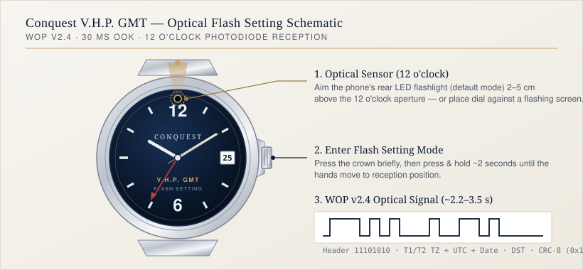

# Optical Flash Time Transmission (WOP v2.4)

Web-based optical flash time & date transmitter designed as a modern replacement for the legacy Flash Setting mobile application.



> **Compatibility Notice / Informacja o kompatybilności**
>
> **EN:** Currently this application supports **Longines Conquest V.H.P. GMT** (Flash Setting) only. It is unknown whether it will work with other watches.
>
> **PL:** Na razie aplikacja wspiera wyłącznie zegarek **Longines Conquest V.H.P. GMT** (Flash Setting) i nie wiadomo, czy będzie działać z innymi zegarkami.

**Live app (GitHub Pages):** https://cino893.github.io/optical-flash-time-transmission/

---

## Features / Funkcje

- **Phone Rear LED Flashlight (Default / Domyślne)** — primary transmission mode matching the original app via WebRTC `MediaTrackConstraints` (`torch`) on Android Chrome / Edge / Samsung Internet, with optional camera alignment preview and rising-edge latency compensation.
- **Screen / Monitor Flash (Fallback for desktop PCs, laptops & iOS Safari)** — full-screen pure black/white (`#000000` / `#FFFFFF`) optical flashing mode for desktop monitors, laptops, and browsers without rear LED torch API access.
- **Bilingual UI (English / Polski)** with instant language toggle.
- **Home Time (T1)** and **Travel Time (T2)** dual timezone support.
- **Automatic DST calculation** using the browser's IANA timezone database (`Intl.DateTimeFormat`), generating exact yearly Summer/Winter transition events.
- **Sub-second UTC synchronization** — aligns the end of the stuffed frame to the next whole UTC second boundary.
- **Hidden Calibration & Protocol Inspector** — collapsed by default; includes adjustable bit period (`30 ms` default), rising-edge turn-on offset, custom UTC override, and live binary/waveform visualization.

---

## Reverse-Engineered Protocol Summary (WOP v2.4)

| Element | Width | Details |
| --- | --- | --- |
| `ProtHeader` | 8 bits | `11101010` (`117 << 1`) |
| `ProtLength` | 4 bits | Sub-message count (`0001` without DST, `0010` with DST) |
| `ProtOpcode` (1) | 8 bits | `57` (`TZ_TIME_DATE_T1` Home) or `58` (`TZ_TIME_DATE_T2` Travel) |
| `TimezonePayload` | 8 bits | `hourShift` (5b signed two's complement, `-12..+15`), `minuteShift` (2b: `0=0m`, `1=30m`, `2=45m`), `hemisphere` (1b: `0=N`, `1=S`) |
| `TimePayload` | 17 bits | UTC `hour` (5b, `0..23`), `minute` (6b, `0..59`), `second` (6b, `0..59`) |
| `DatePayload` | 16 bits | `year % 100` (7b, `0..99`), `month` (4b, `1..12`), `day` (5b, `1..31`) |
| `ProtOpcode` (2, optional) | 8 bits | `59` (`DST_DATE_TIME_SUMMER_WINTER_T1`) or `60` (`T2`) |
| `DstPayload` (optional) | 30 bits | Summer (15b) + Winter (15b): `season` (1b: `0=SUMMER`, `1=WINTER`), `month` (4b), `day` (5b), `hour` (5b) |
| `CRC-8` | 8 bits | Polynomial `263` (`0x107`: $x^8 + x^2 + x + 1$) over all bits after `ProtHeader` |
| Bit stuffing | — | Bipolar 5-bit stuffing (after 5 identical bits, insert inverted bit; stuff bit counts as bit #1 of the next run) |
| Trailer | 2 bits | Two trailing `0` bits (`00`) + 1 final bit period hold |
| Timing | — | OOK (`1 = ON`, `0 = OFF`), default `30 ms` bit period (`10..100 ms`), optional rising-edge offset |

---

## Local Development & Tests

```bash
# Run protocol & timezone unit tests
node --test tests/wop-protocol.test.mjs

# Serve locally (camera/torch requires HTTPS or localhost)
python -m http.server 8080
```
